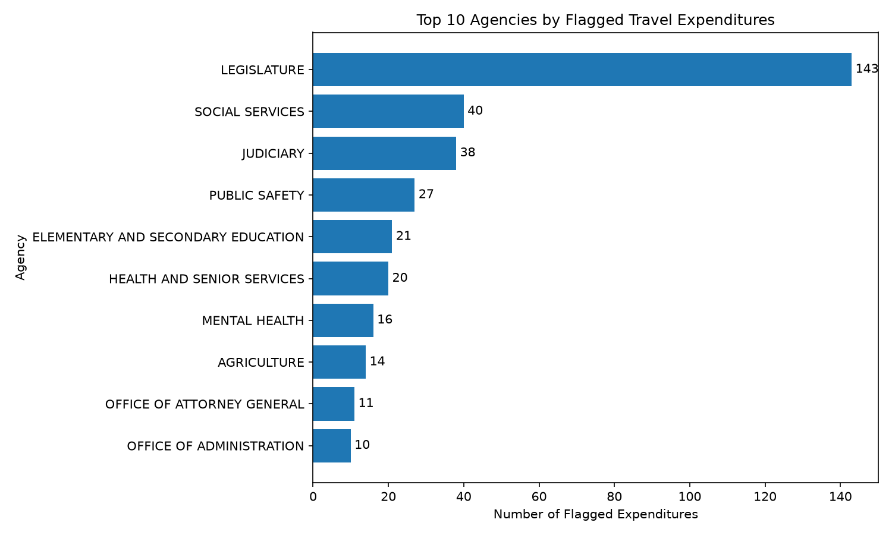

# Static Anomaly Detection

Continuous Intelligence | Project 02 | Example Report

## Overview

This project investigates how simple domain thresholds
can identify unusual observations in static tabular data.

The example analyzes pediatric clinic records to identify
ages and heights outside defined upper limits.

## Data

The dataset contains 22 patient observations with:

- `age_years` - patient age in years.
- `height_inches` - patient height in inches.

[View Example Dataset](https://github.com/denisecase/cintel-02-static-anomalies/blob/main/data/clinic_data.csv)

## Methods

The pipeline uses Python and Polars to read the data
and identify observations meeting either condition:

- Age greater than or equal to 16 years.
- Height greater than or equal to 72 inches.

These are example screening rules, not clinical standards.

Records meeting either condition are saved as anomalies.

## Results

The example pipeline identified **3 anomalous records**.

| Age (years) | Height (inches) | Reason           |
| ----------- | --------------- | ---------------- |
| 12          | 95              | Height threshold |
| 10          | 72              | Height threshold |
| 120         | 66              | Age threshold    |

[View Anomaly Results](https://github.com/denisecase/cintel-02-static-anomalies/blob/main/artifacts/anomalies.csv)

## Threshold Experiment

I changed the maximum age threshold from 16 years to 12 years to see how a more restrictive threshold would affect the results.

I predicted that lowering the age threshold would cause more records to be flagged as anomalies because patients older than 12 would now exceed the threshold.

The original project identified 3 anomalies. After changing the age threshold to 12 years, the project identified 8 anomalies.

This experiment showed that the choice of threshold can significantly affect the results. If a threshold is too restrictive, normal observations may be flagged as anomalies, creating false positives.

## Custom Project: Missouri Travel Expenditures

For my custom project, I analyzed 2026 Missouri state expenditure data
to identify unusually large travel expenditures.

The dataset contained 102,540 expenditure records. Of those,
37,402 were categorized as travel expenditures.

### Method

I converted the payment amounts to numeric values and filtered the data
to include only travel expenditures. I used the 99th percentile of
travel payments as the anomaly threshold.

The calculated threshold was $10,110.40. Travel expenditures at or
above this amount were flagged for further review.

### Results

The analysis identified 404 flagged travel expenditures across
23 state agencies.

### Visualization

The Legislature had the largest number of flagged travel expenditures
with 143 records. Social Services had 40, and the Judiciary had 38.

These results do not mean the expenditures were incorrect or improper.
They identify unusually large travel payments based on the selected
statistical threshold and may warrant additional review.

## Interpretation

The results demonstrate that threshold-based detection
can identify observations requiring further investigation.

The records do not necessarily indicate incorrect data.
They identify values that warrant review.

For example, the recorded age of 120 years suggests
a possible data-entry or population-classification issue.

## Limitations

The current rules detect only values exceeding upper limits.

Unusually small measurements, such as a height of 5 inches
for an eight-year-old, are not detected.

A stronger approach would consider lower limits,
age-dependent expectations, and domain knowledge.

## Conclusion

Static anomaly detection provides a simple,
interpretable approach for screening observations.

The same principles can be applied repeatedly as
new observations arrive in a monitoring system.

## Documentation Index

- **Home** - this landing page
- [**Project Instructions**](project-instructions.md)
- [**Glossary**](glossary.md)
- [**API**](api.md)
- [**Reactive App**](./app/index.html)

## Project Links

- [GitHub Repository](https://github.com/denisecase/cintel-02-static-anomalies)
- [Example Pipeline](https://github.com/denisecase/cintel-02-static-anomalies/blob/main/src/cintel/anomaly_detector.py)
- [Results and Artifacts](https://github.com/denisecase/cintel-02-static-anomalies/tree/main/artifacts)

## Project Resources

- [Project Instructions](project-instructions.md)
- [Professional Python Guide](https://denisecase.github.io/pro-analytics-02/)
- [Professional Python Project Explainer](https://pup-pack.github.io/professional-python-project-explainer/).
- [Suggested Datasets](https://denisecase.github.io/pro-analytics-02/reference/datasets/cintel/)
